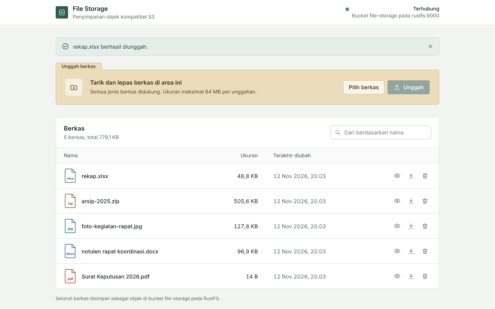

# File Storage

Layanan penyimpanan berkas berbasis object storage kompatibel S3 (RustFS), dengan akun pengguna, peran, tautan berbagi berbatas waktu, dan log aktivitas. Dibuat sebagai modular monolith: satu binary Go berisi API dan UI TypeScript yang sudah di-*build*, dijalankan berdampingan dengan RustFS lewat Docker Compose.



## Fitur

| Fitur | Keterangan |
|---|---|
| Masuk dan keluar | Sesi berbasis cookie `HttpOnly` dan `SameSite=Lax`. Token sesi disimpan sebagai hash SHA-256. |
| Administrator awal | Dibuat otomatis dari `ADMIN_EMAIL` dan `ADMIN_PASSWORD` saat start pertama. |
| Peran | `admin`: akses penuh. `member`: unggah, unduh, bagikan, dan hapus berkas miliknya sendiri. |
| Manajemen pengguna | Admin dapat menambah pengguna, mengubah peran, menonaktifkan, dan mengatur ulang kata sandi. Sistem menjaga minimal satu admin aktif. |
| Ganti kata sandi | Setiap pengguna dapat mengganti kata sandinya sendiri. |
| Metadata berkas | Disimpan di SQLite: pemilik, nama asli, ukuran, tipe, jenis, waktu unggah. |
| Object key berbasis UUID | `files/2026/11/<uuid>.pdf`. Berkas dengan nama sama tidak saling menimpa. |
| Filter dan pencarian | Tab per jenis (Dokumen, Gambar, Spreadsheet, Arsip, Lainnya) dan pencarian nama. |
| Validasi unggahan | Daftar ekstensi, batas ukuran per berkas dan per unggahan, serta pemeriksaan isi berkas (misalnya PDF palsu ditolak). |
| Tautan berbagi | Presigned URL S3 berbatas waktu (1 jam sampai 7 hari). Penerima mengunduh langsung dari RustFS tanpa login. |
| Log aktivitas | Mencatat masuk, gagal masuk, unggah, hapus, berbagi, dan perubahan pengguna, lengkap dengan alamat IP. |
| Perlindungan | Pembatasan percobaan masuk (5 kali per 15 menit), header CSRF wajib untuk permintaan yang mengubah data, kata sandi di-*hash* dengan PBKDF2-SHA256. |
| Status koneksi | Indikator di header memeriksa koneksi ke bucket setiap 15 detik. |

## Arsitektur

```
Browser ──HTTP──> file_storage_app (Go, :8000) ──S3 API──> file_storage_rustfs (:9000)
   │               ├─ /api/*   JSON API                       └─ volume rustfs_data
   │               ├─ /        UI (TypeScript, embedded)
   │               └─ SQLite   metadata, pengguna, sesi, log  ── volume app_data
   │
   └──presigned URL (tautan berbagi)──────────────────────────> RustFS :9000
```

Isi berkas hanya disimpan di RustFS. Aplikasi menyimpan metadata di SQLite. Tautan berbagi mengarah langsung ke RustFS, sehingga unduhan tidak melewati server aplikasi.

## Struktur

```
cmd/server/            entrypoint: config, database, admin awal, storage, HTTP server
internal/config/       baca dan validasi environment variable (fail fast)
internal/database/     koneksi SQLite dan migrasi (migrations/*.sql)
internal/auth/         hash kata sandi, sesi, pembatasan percobaan masuk
internal/users/        akun dan peran
internal/files/        metadata berkas, kebijakan unggah, object key
internal/audit/        log aktivitas
internal/storage/      client S3: put, get, delete, presigned URL
internal/httpapi/      router, middleware (auth, CSRF), handler JSON API, serve UI
internal/webui/        embed hasil build frontend ke binary
web/                   frontend TypeScript + Vite (Bun), tanpa framework
  src/views/           halaman: masuk, berkas, pengguna, log aktivitas, shell
  src/ui/              komponen: uploader, dialog, tautan berbagi, notifikasi, status
Dockerfile             produksi, 3 tahap: build UI → build Go → runtime Alpine
Dockerfile.dev         development: Go + air untuk hot reload
docker-compose.yml     stack produksi: app + RustFS, semua nilai dari .env
compose.dev.yml        stack development terpisah: bind mount, hot reload, RustFS sendiri
```

## Konfigurasi

Semua konfigurasi lewat `.env` (salin dari `.env.example`). File `.env` tidak ikut ke Git.

| Variabel | Wajib | Default | Keterangan |
|---|---|---|---|
| `ADMIN_EMAIL` | ya | | Email administrator awal |
| `ADMIN_PASSWORD` | ya | | Kata sandi administrator awal, minimal 8 karakter |
| `ADMIN_NAME` | tidak | `Administrator` | Nama administrator awal |
| `RUSTFS_ACCESS_KEY` | ya | | Access key RustFS, dipakai juga oleh aplikasi |
| `RUSTFS_SECRET_KEY` | ya | | Secret key RustFS |
| `S3_BUCKET` | ya | | Nama bucket, dibuat otomatis saat start |
| `S3_PUBLIC_ENDPOINT` | tidak | kosong | Alamat RustFS yang bisa dibuka browser, misalnya `http://192.168.122.100:9000`. Kosong berarti tautan berbagi nonaktif. |
| `S3_REGION` | tidak | `us-east-1` | Region untuk tanda tangan SigV4 |
| `MAX_FILE_MB` | tidak | `25` | Batas ukuran satu berkas |
| `MAX_UPLOAD_MB` | tidak | `64` | Batas total satu kali unggah |
| `ALLOWED_EXTENSIONS` | tidak | daftar bawaan | Ekstensi yang diizinkan, dipisah koma |
| `SESSION_TTL_HOURS` | tidak | `12` | Lama sesi masuk |
| `SHARE_MAX_HOURS` | tidak | `168` | Masa berlaku maksimum tautan berbagi (batas S3: 7 hari) |
| `COOKIE_SECURE` | tidak | `false` | Isi `true` jika aplikasi diakses lewat HTTPS |
| `APP_PORT`, `S3_API_PORT`, `S3_CONSOLE_PORT` | tidak | `8000`, `9000`, `9001` | Port produksi di host |
| `DEV_APP_PORT`, `DEV_WEB_PORT`, `DEV_S3_API_PORT`, `DEV_S3_CONSOLE_PORT` | tidak | `8100`, `5173`, `9100`, `9101` | Port stack development |
| `DEV_S3_PUBLIC_ENDPOINT` | tidak | kosong | Alamat RustFS dev untuk tautan berbagi di stack development |

Akun administrator awal hanya dibuat jika emailnya belum terdaftar. Mengubah `ADMIN_PASSWORD` setelah itu tidak mengubah kata sandi akun yang sudah ada; gunakan menu Ganti kata sandi.

## Menjalankan (mode produksi)

Prasyarat: Docker Engine dan Docker Compose v2. Port 8000, 9000, dan 9001 harus kosong.

```bash
git clone https://github.com/zhafrandzaky/file-storage.git
cd file-storage
cp .env.example .env
nano .env                       # isi ADMIN_*, RUSTFS_*, dan S3_PUBLIC_ENDPOINT
docker compose up -d --build
```

Cek:

```bash
docker compose ps               # file_storage_app harus (healthy)
docker compose logs app         # "admin account created", "listening", share_links=true
curl -s localhost:8000/api/health
```

Akses dari browser:

- Aplikasi: `http://<IP_SERVER>:8000`, masuk dengan `ADMIN_EMAIL` dan `ADMIN_PASSWORD`
- RustFS Console: `http://<IP_SERVER>:9001`, masuk dengan `RUSTFS_ACCESS_KEY` dan `RUSTFS_SECRET_KEY`

## Mode development (stack terpisah, bind mount, hot reload)

`compose.dev.yml` adalah stack tersendiri (project `file-storage-dev`) dengan container, port, network, dan volume sendiri. Stack ini bisa berjalan bersamaan dengan produksi tanpa saling mengganggu, dan datanya tidak tercampur.

```bash
docker compose -f compose.dev.yml up -d --build
docker compose -f compose.dev.yml ps
```

| Container | Isi | Akses |
|---|---|---|
| `file_storage_dev_web` | `./web` di-mount ke `/web`; Vite dengan hot module replacement, `/api` diteruskan ke app dev | UI `http://<IP_SERVER>:5173` |
| `file_storage_dev_app` | `./` di-mount ke `/src`; `air` membangun ulang dan me-restart server setiap file `.go` atau `.sql` berubah | API `http://<IP_SERVER>:8100/api` |
| `file_storage_dev_rustfs` | RustFS terpisah dengan data sendiri | S3 `:9100`, Console `:9101` |

Isi `DEV_S3_PUBLIC_ENDPOINT` (misalnya `http://192.168.122.100:9100`) agar tautan berbagi aktif di stack dev.

| | Produksi | Development |
|---|---|---|
| Perintah | `docker compose ...` | `docker compose -f compose.dev.yml ...` |
| Kode | di-*build* ke dalam image | di-*mount* dari host, berubah langsung |
| UI | `:8000` | `:5173` |
| RustFS | `:9000`, `:9001` | `:9100`, `:9101` |
| Volume | `file-storage_app_data`, `file-storage_rustfs_data` | `file-storage-dev_app_data`, `file-storage-dev_rustfs_data` |

### Alur dari development ke produksi

1. Ubah kode di folder project. Perubahan langsung terlihat di stack dev (`:5173`).
2. Jalankan tes: `docker compose -f compose.dev.yml exec app go test ./...`
3. Simpan perubahan: `git add -A && git commit -m "..." && git push`
4. Build ulang dan jalankan produksi dari kode yang sama:

   ```bash
   docker compose up -d --build
   ```

   Hanya container app produksi yang dibuat ulang. Data produksi tetap, dan migrasi database baru dijalankan otomatis saat start.

Menghentikan stack dev tanpa menyentuh produksi:

```bash
docker compose -f compose.dev.yml down        # data dev tetap
docker compose -f compose.dev.yml down -v     # hapus data dev saja
```

### Lewat Portainer

Portainer tidak bisa mem-*build* dari folder di host, jadi build image-nya dulu:

```bash
docker compose build
```

Lalu di Portainer: Stacks → Add stack → tempel isi `docker-compose.yml`, **hapus baris `build: .`**, dan isi variabel `.env` di bagian Environment variables. Deploy the stack.

### Persiapan sebelum lab tanpa internet

Jalankan sekali saat masih ada internet:

```bash
docker compose pull rustfs
docker compose build
docker pull amazon/aws-cli:latest
# jika ingin memakai stack development:
docker compose -f compose.dev.yml build
docker compose -f compose.dev.yml pull web rustfs
```

## API

Semua endpoint kecuali `/api/health` dan `/api/auth/login` membutuhkan sesi. Permintaan selain `GET` wajib menyertakan header `X-Requested-With`.

| Method | Path | Akses | Fungsi |
|---|---|---|---|
| `GET` | `/api/health` | publik | Status aplikasi dan koneksi ke bucket |
| `POST` | `/api/auth/login` | publik | Masuk (`{"email","password"}`) |
| `POST` | `/api/auth/logout` | pengguna | Keluar |
| `GET` | `/api/auth/me` | pengguna | Data akun yang sedang masuk |
| `POST` | `/api/auth/password` | pengguna | Ganti kata sandi sendiri |
| `GET` | `/api/info` | pengguna | Bucket, batas unggah, ekstensi, status tautan berbagi |
| `GET` | `/api/files?kind=&q=` | pengguna | Daftar berkas dan ringkasan per jenis |
| `POST` | `/api/files` | pengguna | Unggah (multipart, field `files`) |
| `GET` | `/api/files/{id}` | pengguna | Buka berkas; tambahkan `?download` untuk mengunduh |
| `DELETE` | `/api/files/{id}` | pemilik atau admin | Hapus berkas |
| `POST` | `/api/files/{id}/share` | pengguna | Buat tautan berbagi (`{"hours":24}`) |
| `GET` | `/api/users` | admin | Daftar pengguna |
| `POST` | `/api/users` | admin | Tambah pengguna |
| `PATCH` | `/api/users/{id}` | admin | Ubah peran atau status (`{"role"}`, `{"active"}`) |
| `POST` | `/api/users/{id}/password` | admin | Atur ulang kata sandi |
| `GET` | `/api/audit?limit=200` | admin | Log aktivitas terbaru |

Contoh dengan `curl`:

```bash
H='X-Requested-With: curl'
curl -c jar -H "$H" -H 'Content-Type: application/json' \
  -d '{"email":"admin@example.com","password":"..."}' localhost:8000/api/auth/login
curl -b jar -H "$H" -F "files=@example.pdf" localhost:8000/api/files
curl -b jar localhost:8000/api/files
```

Error selalu berbentuk `{"error": {"code": "...", "message": "..."}}`.

### Verifikasi langsung ke RustFS dengan AWS CLI

```bash
set -a; . ./.env; set +a
docker run --rm --network container:file_storage_rustfs \
  -e AWS_ACCESS_KEY_ID=$RUSTFS_ACCESS_KEY -e AWS_SECRET_ACCESS_KEY=$RUSTFS_SECRET_KEY \
  amazon/aws-cli:latest --endpoint-url http://127.0.0.1:9000 s3 ls --recursive s3://$S3_BUCKET
```

## Tes

```bash
go test ./...                   # butuh gcc karena SQLite memakai CGO
cd web && bun run typecheck
```

## Troubleshooting

| Gejala | Penyebab dan solusi |
|---|---|
| `required variable ... is missing` | `.env` belum dibuat atau variabel kosong. Jalankan `cp .env.example .env` lalu isi. |
| `port is already allocated` | Port dipakai container lain. Cek `docker ps`, atau ganti port di `.env`. |
| Tombol bagikan tidak muncul | `S3_PUBLIC_ENDPOINT` kosong. Isi dengan alamat RustFS yang bisa dibuka browser, lalu `docker compose up -d`. |
| Tautan berbagi menampilkan `SignatureDoesNotMatch` | `S3_PUBLIC_ENDPOINT` tidak sama persis dengan alamat yang dibuka penerima (host atau port berbeda). |
| Tidak bisa masuk setelah mengubah `ADMIN_PASSWORD` | Kata sandi akun yang sudah ada tidak ikut berubah. Masuk dengan kata sandi lama, atau hapus volume `app_data` untuk memulai dari awal. |
| `Terlalu banyak percobaan masuk` | Tunggu 15 menit, atau restart container app. |
| App restart terus, log `ensure bucket` | RustFS belum siap atau kredensial salah. Cek `docker compose logs rustfs` dan nilai di `.env`. |
| Halaman tidak terbuka dari host | Firewall: `sudo ufw allow 8000,9000,9001/tcp`. |

## Menghentikan

```bash
docker compose stop          # hentikan, data tetap ada
docker compose down          # hapus container, data tetap ada di volume
docker compose down -v       # HAPUS SEMUA DATA: berkas, pengguna, dan log
```
